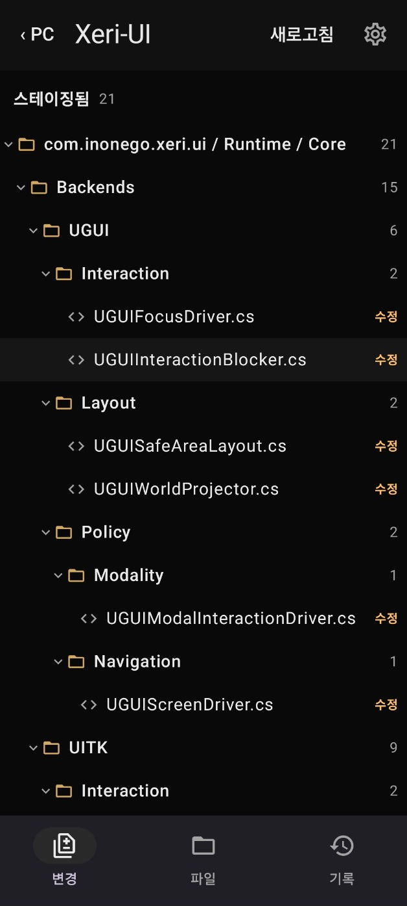
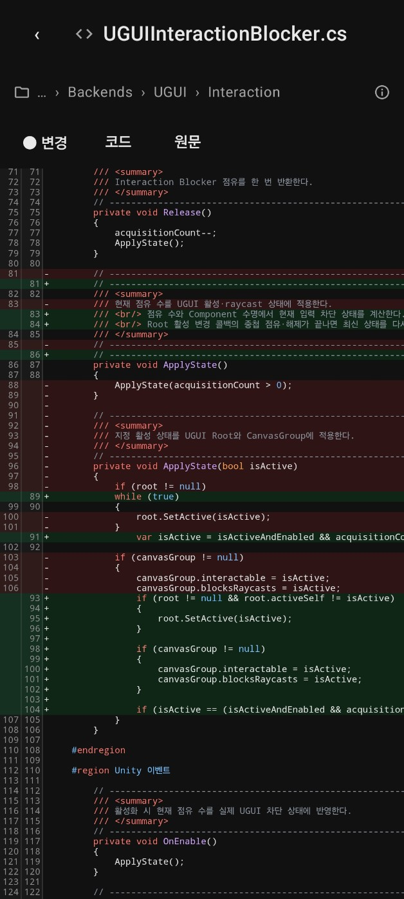

# Prismo

[](https://github.com/inonego-ai/prismo)
[](https://github.com/inonego-ai/prismo/actions/workflows/ci.yml)
[](#features)
[](LICENSE)

<p align="center">
  
  
</p>

View your PC's Git repositories from your Android device, without pushing or cloning your work.

## Features

- Browse repositories, folders, and files.
- Review staged, unstaged, and untracked changes with diffs.
- Explore commit history and changed files.
- Connect devices with a one-time QR code over a private connection.
- Restrict access to common sensitive paths.
- Optionally start the Windows desktop agent at login from the Settings menu (tray-only startup).

Git access is read-only. Connections authenticate both the Iroh peer identity and a per-device token; relays may observe connection metadata.

## Build from source

From the project root, build the Windows app:

```powershell
cd agent
npm ci
cd ../desktop
npm ci
npm run portable
```

For Android (JDK 21, Android SDK, and Node.js 24+ installed), build from the project root:

```powershell
cd renderer
npm ci
cd ..\android
.\gradlew.bat :app:assembleDebug
```

## License

[MIT](LICENSE) · [Third-party licenses](docs/OPEN_SOURCE_LICENSES.md)
